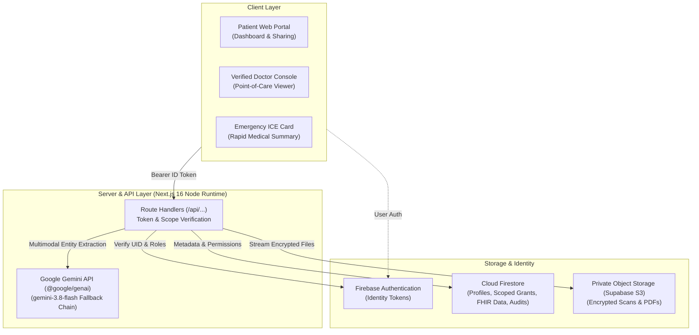

# Zymore Health

> **The patient-centric, interoperable medical vault bridging clinical fragmentation across emergency and cross-hospital care.**

[](https://nextjs.org/)
[](https://aistudio.google.com/)
[](https://firebase.google.com/)
[](https://www.typescriptlang.org/)
[](https://hl7.org/fhir/)

---

## 🏥 The Problem

When patients seek treatment in emergency rooms or follow-up consultations at different hospitals, attending doctors cannot access consolidated medical histories, prior prescriptions, ongoing medication regimens, or critical drug allergy records. 

Health records remain trapped in proprietary hospital database silos or lost paper files, leading to:
* **Preventable Adverse Drug Events (ADEs):** Prescribing medications that trigger severe allergic reactions or dangerous drug-drug interactions.
* **Emergency Treatment Delays:** Doctors losing vital golden-hour minutes trying to uncover baseline conditions.
* **Redundant Diagnostic Costs:** Patients undergoing repeated, expensive blood tests and imaging.

---

## 💡 The Zymore Solution

Zymore Health gives patients complete sovereignty over their medical history while providing doctors with instantaneous, verified clinical context:

1. **Multimodal Medical Ingestion (Google Gemini):**
   * Upload prescriptions, discharge summaries, and lab reports (PDF, JPEG, PNG, WebP).
   * Google Gemini extracts structured medical entities (medication names, dosages, reference ranges, dates) with confidence scoring.
   * **Human-in-the-Loop Safeguard:** Extracted data requires patient confirmation before it enters the active health summary.

2. **Emergency Point-of-Care Allergy Alerts:**
   * High-visibility **Critical Drug Allergy Alerts** automatically surface when an authorized doctor reviews the patient's record.
   * Highlights life-critical contraindications (e.g., Penicillin, Sulfa, NSAIDs) immediately.

3. **In-Case-of-Emergency (ICE) Medical Card:**
   * One-click emergency profile displaying blood group, known drug allergies, active medication regimens, and verified emergency contacts.

4. **Zero-Trust Doctor Sharing Protocol:**
   * Patients share access using a verified doctor's unique ID (`ZMD-...`).
   * Configurable granular scopes (`profile`, `history`, `records`, `add_records`) and time-limited durations (1 hour to 7 days).
   * Instant revocation with a complete, tamper-evident audit log.

5. **HL7 FHIR & ABDM Standard Alignment:**
   * Ready for national digital health infrastructure (e.g., India's Ayushman Bharat Digital Mission) using standardized FHIR resource bundles (`Encounter`, `Observation`, `DiagnosticReport`, `MedicationRequest`).

---

## 🏗️ Architecture



---

## 🚀 Quick Start & Local Setup

### Prerequisites
* **Node.js:** `24.x` (or `>= 20.x`)
* **npm:** `>= 10.x`

### 1. Clone the repository
```bash
git clone https://github.com/notyash/zymore-health.git
cd zymore-health
```

### 2. Configure Environment Variables
Copy the template file to `.env.local` inside `apps/web`:
```bash
cp .env.example apps/web/.env.local
```
Fill in your credentials:
* **Firebase:** Web app credentials + service account JSON.
* **Google Gemini:** API Key from [Google AI Studio](https://aistudio.google.com/).
* **Supabase:** S3 credentials and private bucket name (`health-records`).

### 3. Install & Run
```bash
# Install dependencies across workspaces
npm install

# Run the development server
npm run dev
```

Open [http://localhost:3000](http://localhost:3000) in your browser.

---

## 🛠️ Project Structure

```text
zymore-health/
├── apps/
│   └── web/                     # Next.js 16 App Router application
│       ├── src/
│       │   ├── app/             # App router pages & REST API endpoints
│       │   │   ├── api/         # Authenticated server route handlers
│       │   │   ├── dashboard/   # Patient medical vault & ICE modal
│       │   │   ├── doctor/      # Verified doctor portal & point-of-care viewer
│       │   │   ├── onboarding/  # Profile setup with allergy & contact inputs
│       │   │   └── access/      # Grant management & audit logs
│       │   └── lib/             # Firebase Admin, Gemini, & Storage clients
│       └── package.json
├── docs/
│   └── ARCHITECTURE.md          # Detailed technical & security specification
├── firebase/
│   └── firestore.rules          # Strict server-only rules (deny client writes)
├── .env.example                 # Comprehensive environment variable template
└── package.json                 # Monorepo root configuration
```

---

## 📋 Available Scripts

* `npm run dev` — Starts the local Next.js development server.
* `npm run build` — Builds the application for production deployment (e.g. Vercel).
* `npm run check` — Runs TypeScript strict type checking across all packages.
* `npm start` — Runs the compiled production build.

---

## 🔒 Security & Privacy by Design

* **Zero Direct Client Access:** Firestore security rules deny all direct browser reads and writes. Privileged operations stay strictly within server route handlers.
* **Granular Consent Engine:** Distinct consent controls for data storage, Gemini summaries, document OCR, and doctor sharing. Disabling AI consent immediately purges cached insights.
* **Expiring Scoped Grants:** Doctors can only view authorized sections (`profile`, `history`, `records`, `add_records`) during active grant windows.
* **Immutable Audit Trail:** All access events are recorded with actor identities and timestamps, empowering patients to inspect access history and report concerns.

---

## 📄 License

This project is licensed under the Apache 2.0 License.
